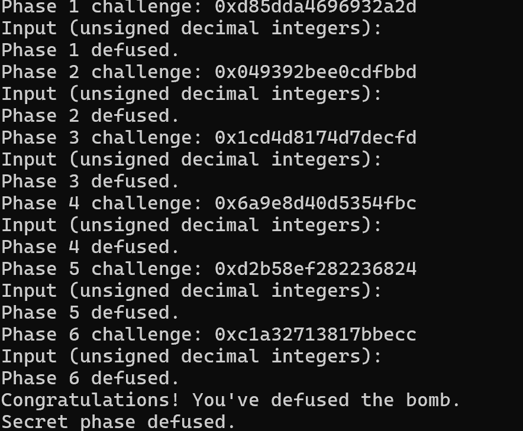

# Lab 2: Bomb Lab 实验报告

## 1. 实验方法与约定

本实验的目标是从个人 `bomb` 的 x86-64 汇编中恢复出对任意 `challenge` 都成立的计算关系，并在 `defuser.c` 中生成口令。分析时主要使用 GDB 的 `disassemble`、GNU `objdump` 和 `nm` 查看函数、跳转表、函数指针表与只读数据，再通过 `make`、单关管道测试和 `public_test.py` 验证。

下文记：

- `C` 为 64 位 `challenge`；
- `L = (uint32_t)C`，`H = (uint32_t)(C >> 32)`；
- 所有 `uint32_t` 加、乘、移位和异或均按模 $2^{32}$ 计算；
- `low32(x)` 表示只保留 `x` 的低 32 位。

## 2. Phase 1：函数调用与返回值组合

`phase_01` 读入一个无符号整数，调用 `p1_compute(challenge)`，再将返回值与输入比较。核心函数中依次调用三个步骤：

```asm
p1_step0:
    lea eax, [rsi+0x8b9d]
    xor eax, edi

p1_step1:
    lea eax, [rdi+rsi*4]
    xor eax, 0x7cc4

p1_step2:
    lea eax, [rdi+rdi*4]
    add eax, esi
    xor eax, 0xf35c
```

`p1_compute` 将 `L`、`H` 和 `low32(C >> 16)` 分配给上述步骤。令

```text
M  = low32(C >> 16)
s0 = (H + 0x8b9d) ^ L
s1 = (H + 4*M) ^ 0x7cc4
s2 = (5*s1 + L) ^ 0xf35c
```

最终口令为：

```text
answer = s2 ^ s0
```

因此本关输出一个无符号十进制整数。

## 3. Phase 2：循环与递推数组

`phase_02` 要求六个整数。第一项由 `challenge` 的第 32 位起的 6 个比特决定：

```asm
shr rax, 0x20
and eax, 0x3f
add eax, 0xc
```

所以

```text
a[0] = ((C >> 32) & 0x3f) + 12
```

后续五项在循环中生成。寄存器 `ecx` 从 `0x14` 开始，每轮增加 4；`edx` 是下标 `i`，从 1 增加到 5：

```asm
shr rax, cl
and eax, 0x3f
add eax, edx
xor eax, esi
lea eax, [rax+rax*2]
```

恢复出的递推式为：

```text
a[i] = 3 * ((((C >> (16 + 4*i)) & 0x3f) + i) ^ a[i-1]),  i=1,...,5
```

六项按顺序输出。

## 4. Phase 3：跳转表与分支计算

本关先取低三位作为跳转表下标，并构造分支参数：

```text
index = L & 7
x = low32((C >> 3) ^ (C >> 32))
```

`p3_dispatch` 使用 `jmp QWORD PTR [rax*8+0x405820]` 间接跳转。根据跳转表地址和各 case 函数，得到：

| `index` | 实际 case | `answer` |
|---:|---|---|
| 0 | `p3_case_7` | `5*x + 0x3cd93` |
| 1 | `p3_case_3` | `(x ^ 0x409f) + (x >> 1)` |
| 2 | `p3_case_1` | `5*x + 0x3395a` |
| 3 | `p3_case_6` | `5*x + 0xb422` |
| 4 | `p3_case_0` | `3*x + 0xc7a4` |
| 5 | `p3_case_4` | `(x ^ 0x16c8) + (x >> 1)` |
| 6 | `p3_case_2` | `(4*x) ^ 0xd3f3` |
| 7 | `p3_case_5` | `(4*x) ^ 0x37c8` |

`phase_03` 先比较第一个输入和 `index`，再比较第二个输入和分支返回值，因此输出顺序是：

```text
index answer
```

调试时曾将 `p3_case_5` 的 `lea eax,[rdi*4]` 误读成五倍，导致两个公开 seed 失败。重新核对该 case 后改为 `4*x`，全部公开测试通过。

## 5. Phase 4：递归二分遍历

调用 `p4_walk` 前，`phase_04` 构造：

```text
target = L & 0x7f
key = low32(C >> 7) ^ H
```

初始调用为 `p4_walk(target, 0, 127, key)`。函数先计算中点：

```asm
mov edi, edx
sub edi, esi
shr edi, 1
add edi, esi
```

对应

```text
mid = low + ((high - low) >> 1)
```

递归返回规则为：

```text
walk(target, low, high, key):
    mid = low + ((high-low) >> 1)

    if target == mid:
        return (mid + 0x43) ^ key

    mix = mid + key
    if target < mid:
        return ((5 * walk(target, low, mid-1, key)) ^ mix) ^ 0x04
    else:
        return ((5 * walk(target, mid+1, high, key)) ^ mix) ^ 0x1f
```

`target` 始终位于 `[0,127]`，每次递归都缩小区间，因此最终一定到达基例。本关输出递归的最终返回值。

## 6. Phase 5：结构体、指针和链表

`p5_traverse` 先通过 `challenge & 7` 从 `p5_heads` 中选取头指针。节点访问方式表明结构体布局为：

```c
struct node {
    struct node *next;   // 偏移 0
    uint32_t value;      // 偏移 8
    uint32_t weight;     // 偏移 12
};
```

八个头指针分别指向同一条链的第 0 至第 7 个位置。最多再前进三次，因此实际可访问位置为 0 至 10：

| 位置 | `value` | `weight` |
|---:|---:|---:|
| 0 | 273 | 18063 |
| 1 | 1915 | 59068 |
| 2 | 570 | 13961 |
| 3 | 784 | 51946 |
| 4 | 2661 | 17775 |
| 5 | 1387 | 50792 |
| 6 | 2144 | 14539 |
| 7 | 91 | 4275 |
| 8 | 2348 | 48741 |
| 9 | 1571 | 34307 |
| 10 | 2910 | 24637 |

起点、访问节点数和初始哈希为：

```text
start = L & 7
steps = ((L >> 3) & 3) + 1
hash = low32(C >> 6) ^ H ^ 0x4067
```

每访问一个节点执行：

```text
hash = ((hash + node.weight) * 5) ^ node.value
```

`p5_traverse` 返回最终 `hash`，并通过指针参数写回最后一个节点的 `value`。所以本关输出：

```text
hash final_value
```

## 7. Phase 6：函数指针表与间接调用

`p6_dispatch` 构造：

```text
x  = low32(C >> 6) ^ H
i1 = L & 7
i2 = (L >> 3) & 7
```

随后按函数指针表调用两次操作：

```asm
call QWORD PTR [rax*8+0x405e00]
xor  eax, 0x1491
call QWORD PTR [rbx+0x405e00]
add  eax, 0xfff1
```

函数指针表恢复为：

| 下标 | 操作 |
|---:|---|
| 0 | `ROL32(x,3) ^ 0xaef9` |
| 1 | `((x >> 2) ^ x) + 0x6ffa` |
| 2 | `(4*x + 0x9e32) ^ (5*x)` |
| 3 | `ROR32(x,3)` |
| 4 | `(x ^ 0x9d4c) + (x << 7)` |
| 5 | `ROL32(x,3) ^ 0xaef9` |
| 6 | `((x >> 2) ^ x) + 0x6ffa` |
| 7 | `(x + 0x53f) ^ (x >> 2)` |

记表中第 `i` 个操作为 $F_i$，最终答案为：

```text
answer = F_i2(F_i1(x) ^ 0x1491) + 0xfff1
```

循环移位用两个无符号移位和按位或实现，例如 `ROL32(x,3) = (x << 3) | (x >> 29)`。

## 8. Honor：隐藏入口与上下文相关口令

`secret_gate` 先复制第七行，然后检查缓冲区偏移 32 处的四个字节：

```asm
cmp DWORD PTR [rbp-0xb0], 0x4e45504f
lea rdi, [rbp-0xac]
call secret_phase
```

小端序常量 `0x4e45504f` 对应字符串 `OPEN`。因此构造 32 个填充字符，再写入 `OPEN`，第 36 字节起放置三个无符号整数：

```text
AAAAAAAAAAAAAAAAAAAAAAAAAAAAAAAAOPEN s second third
```

令：

```text
s  = low32(context) & 3
cf = low32(challenge) ^ high32(challenge)
xf = low32(context) ^ high32(context)
arg = cf ^ xf
```

`secret_mix` 的汇编为：

```asm
mov eax, edi
xor edi, 0x12f
shr eax, 1
xor eax, 0xcfb2
add eax, edi
```

所以：

```text
mixed  = ((arg >> 1) ^ 0xcfb2) + (arg ^ 0x12f)
second = mixed ^ (s * 0x12f) ^ low32(context >> 16)
third  = second ^ (xf + s + 0xcfb2 + (cf >> 1))
```

驱动程序根据前六行答案生成 `context` 并传入 `solve_secret`，因此解法只需使用函数参数计算，不需要读取文件或保存先前状态。

## 9. 验证

### 9.1 公开测试

修正 Phase 3 的四倍乘法后运行：

```sh
make
python3 public_test.py
```

结果为正式六关 `60/60`，Honor 的公开 seed 也全部通过。

### 9.2 非公开列表 seed

选择不在 `tests/public.json` 中的 `seed=314159`。求解器输出如下：

| 关卡 | 输出 |
|---:|---|
| 1 | `2468425545` |
| 2 | `74 213 741 2172 6330 18846` |
| 3 | `5 1882793476` |
| 4 | `1551722502` |
| 5 | `2075369809 2661` |
| 6 | `2076900131` |
| Honor | `AAAAAAAAAAAAAAAAAAAAAAAAAAAAAAAAOPEN 2 1622926340 2605017684` |

完整验证命令：

```sh
{ ./defuser --seed 314159; ./defuser --seed 314159 --secret; } | ./bomb --seed 314159
```

运行结果：



## 10. 工具、资料与说明

- 课程 Lab 2 文档与 `tutor/phase0_solution.c`：理解接口、输出格式和从汇编恢复 C 表达式的方法。
- GDB：使用 `disassemble` 查看函数和递归、间接调用的控制流。
- GNU `objdump`、`nm`：查看符号、跳转表、函数指针表和 `.rodata` 中的链表节点。
- `make`、`public_test.py`：编译并使用多个 seed 验证解法。
- ChatGPT：协助解释个别 x86-64 指令、核对 32 位无符号运算、检查恢复公式和提交格式。所有公式均重新与个人炸弹汇编核对，并通过公开测试和额外 seed 验证。

参考链接：

- [课程 Bomb Lab 页面](https://ics-26fall-fdu.github.io/labs/lab2-bomb-lab/)
- [GDB 官方文档](https://sourceware.org/gdb/current/onlinedocs/gdb.html)
- [GNU Binutils 文档](https://sourceware.org/binutils/docs/)

## 11. 实验体会

本实验最容易出错的地方不是单条指令，而是数据宽度、跳转表真实映射、输入字段顺序和递归返回阶段的组合运算。将寄存器始终标记为 32 位或 64 位，并用多个 seed 覆盖不同分支，比只验证某个固定 challenge 更可靠。Phase 3 中一次 `4*x`/`5*x` 的误读也说明，分支覆盖不足时单个 seed 通过并不能证明通用公式正确。
